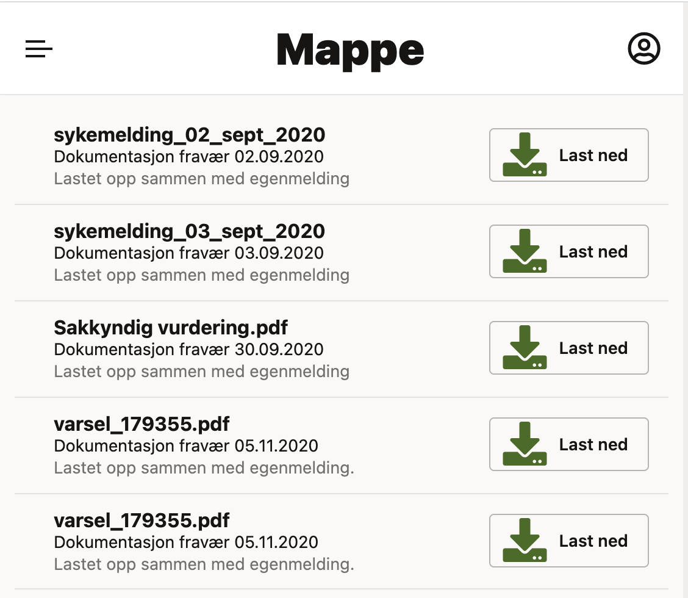

    <ActionCard
      icon={<i className="fa-duotone fa-light fa-right-to-bracket fa-2x" style={{"--fa-primary-color": "rgb(46, 84, 152)", "--fa-secondary-color": "rgb(29, 154, 57)"}}></i>}
      title="Innlogging for elever"
      description="iSkole for elever"
      to="https://iskole.net/elev"
    />

iSkole er skolens digitale portal for elever — ett sted hvor du har full oversikt over skolehverdagen din. Gjennom iSkole får du tilgang til timeplanen din, kan følge med på fravær og karakterer, levere oppgaver, kommunisere med lærere og medelever, og holde orden på viktige dokumenter. Foreldre til elever under 18 år har også tilgang.

Med iSkole slipper du å lure på om du har fravær som ikke er registrert, når neste prøve er, eller hva læreren la ut av fagstoff. Alt er samlet på ett sted, tilgjengelig fra både PC og mobil — når som helst og hvor som helst.

:::tip tips
iSkole kan installeres som en «Progressive Web App», iSkole legger seg da sammen med andre apper på hjemskjermen. 
iOS: Åpne Safari → Åpne [iSkole for elever](https://iskole.net/elev) → Trykk på ... → Del → Legg til på Hjem-skjerm → Velg navn → Legg til.

Android: Brukeren blir automatisk spurt om de ønsker å legge til iSkole som en applikasjon. Hvis du ikke blir spurt kan iSkole legges til manuelt.
Åpne Chrome → Åpne [iSkole for elever](https://iskole.net/elev) → Trykk på ... → _Legg til på startskjermen_ eller _Install app_

I den installerte appen henter du ferske data ved å dra siden ned når du står helt øverst («trekk ned for å oppdatere»).
:::

## Adgangskontroll {#adgangskontroll}

### Innlogging i iSkole
For å logge inn i iSkole må du være registrert som elev ved skolen i inneværende skoleår. Når du slutter ved skolen, mister du tilgangen til iSkole.

Du logger inn på [iskole.net/elev](https://iskole.net/elev), eller med knappen _Innlogging for elever_ øverst på denne siden. Innloggingssiden har fire valg:

- **Feide**: med brukernavnet du har fått fra skolen.
- **Passnøkkel**: med fingeravtrykk, ansiktsgjenkjenning eller koden du låser opp telefonen eller PC-en med. Du må først ha lagret en passnøkkel i iSkole.
- **ID-porten**: med MinID, BankID eller en annen elektronisk ID.
- **Få innloggingslenke på e-post**: iSkole sender en lenke til e-postadressen skolen har registrert på deg.

### Innlogging via FEIDE
De aller fleste skoler tilbyr innlogging med FEIDE. Har du fått tildelt FEIDE-brukernavn kan du logge inn ved å trykke på knappen _Feide_. Dette er den foretrukne måten å logge inn på, og gir deg direkte tilgang mellom skolens ulike læringsressurser.

iSkole kjenner deg igjen på fødselsnummeret ditt, eller på Feide-brukernavnet skolen har registrert på deg i iSkole. Kommer du ikke inn etter at du har logget inn i Feide, må skolen sjekke at Feide-brukernavnet ditt er registrert.

### Innlogging med ID-porten {#innlogging-med-id-porten}
Trykk _ID-porten_ og logg inn med MinID, BankID eller en annen elektronisk ID. iSkole finner deg på fødselsnummeret ditt, så det må være registrert riktig på skolen. ID-porten virker også når skolen ikke har Feide.

### Innloggingslenke på e-post {#innloggingslenke-på-e-post}
1. Trykk _Få innloggingslenke på e-post_ på innloggingssiden.
2. Skriv e-postadressen din og trykk _Send innloggingslenke_.
3. Åpne e-posten «Innlogging til iSkole» og trykk _Logg inn som …_ med navnet ditt.

Dette er greit å vite:

- Lenken er gyldig i 15 minutter og kan bare brukes én gang. Er den gått ut, ber du om en ny.
- Bruk en e-postadresse skolen har registrert på deg. Har skolen registrert to e-postadresser på deg, kan du bruke hvilken som helst av dem.
- Du får samme svar («Sjekk e-posten din») uansett om adressen er registrert eller ikke. iSkole forteller ikke hvilke adresser som finnes.
- Deler flere elever samme e-postadresse, for eksempel søsken, får du én e-post med én lenke per elev. Trykk på lenken med ditt navn.
- Åpne lenken på telefonen eller PC-en du vil logge inn på. Det er der du blir logget inn.

### Passnøkkel {#passnøkkel}
Med en passnøkkel logger du inn med fingeravtrykk, ansiktsgjenkjenning eller koden du låser opp enheten med. Du trenger verken brukernavn eller e-post.

Slik lagrer du en passnøkkel:
1. Logg inn med Feide, ID-porten eller innloggingslenke.
2. Trykk på navnet ditt øverst til høyre (på mobil: profilikonet) og velg _Innstillinger_.
3. Trykk _Lagre passnøkkel…_ under _Passnøkler_, og følg instruksjonene på telefonen eller PC-en.

Neste gang trykker du _Passnøkkel_ på innloggingssiden og bekrefter med fingeravtrykk, ansikt eller kode.

- Passnøkkelen lagres på enheten. Bruker du iCloud-nøkkelring eller Google Passordbehandler, synkroniseres den til de andre enhetene dine. Ellers lagrer du én passnøkkel på hver enhet du bruker.
- Under _Mine passnøkler_ i _Innstillinger_ ser du når hver passnøkkel ble registrert og sist brukt. Med _Slett_ fjerner du en passnøkkel, for eksempel hvis du mister eller gir bort telefonen.
- Passnøkkel virker best på enheter med skjermlås, for eksempel fingeravtrykk, Face ID eller Windows Hello. Har PC-en ikke det, kan du bruke passnøkkelen på telefonen: velg det i vinduet nettleseren viser, og skann QR-koden med telefonen. En sikkerhetsnøkkel virker også.
- Finnes det ingen passnøkkel for iSkole, eller du avbryter, står det en melding på innloggingssiden. Logg da inn på en annen måte.
- Firefox støtter ikke alt. Bruk helst en annen nettleser når du lagrer passnøkkelen.

### Utlogging og tidsavbrudd {#utlogging-og-tidsavbrudd}
Du logger ut med navnet ditt (på mobil: profilikonet) → _Logg ut_.

Du er innlogget til du logger ut, også om du lukker nettleseren. Har du ikke brukt iSkole på 10 timer, eller er det gått 12 timer siden du logget inn, blir du logget ut automatisk og kommer til innloggingssiden.

Logget du inn med Feide eller ID-porten, spør iSkole om du også vil logge ut der: velg _Logg ut av iSkole og Feide_ (eller _… og ID-porten_), _Bare iSkole_ eller _Avbryt_. Logger du ut av ID-porten, blir du også logget ut av andre tjenester du har logget inn på med ID-porten i den samme nettleseren.

:::warning Delt PC
Bruker du en PC som andre også bruker, velger du å logge ut av Feide eller ID-porten også. Velger du _Bare iSkole_, er du fortsatt innlogget i Feide eller ID-porten i nettleseren, og neste person kan komme rett inn.
:::

### Når innloggingen ikke virker {#når-innloggingen-ikke-virker}
- **«Du er ikke registrert som elev ved en skole i iSkole dette skoleåret»:** Du må være registrert som elev ved skolen dette skoleåret, med riktig fødselsnummer. Kontakt skolen.
- **«Vi fant deg ikke i iSkole med denne Feide-brukeren»:** Skolen har ikke registrert fødselsnummeret ditt eller Feide-brukernavnet ditt i iSkole. Logg inn med ID-porten eller innloggingslenke på e-post, og si fra til skolen.
- **«Innloggingen ble avbrutt»:** Du avbrøt hos Feide eller ID-porten. Prøv igjen.
- **«Skolen din har ikke åpnet iSkole for elever ennå» eller «iSkole åpner for elever ved skolen din …»:** Skolen har stengt iSkole for elever en periode. Prøv igjen fra datoen som står i meldingen.
- **Ingen e-post med innloggingslenke:** Sjekk søppelpost. Sjekk at du skrev e-postadressen skolen har registrert på deg. Kontakt skolen hvis du er usikker på hvilken adresse de har.
- **«Innloggingslenken er ugyldig eller utløpt»:** Lenken er eldre enn 15 minutter eller er brukt før. Be om en ny.
- **Melding om at det ikke finnes noen passnøkkel:** Se [Passnøkkel](#passnøkkel).
- **Øverst står «Lukk nettleseren for å aktivere ny versjon av iSkole»:** Lukk nettleseren eller appen helt, og åpne iSkole igjen.

## Utforming av skjermbildet i iSkole
Hovedmenyen i iSkole vises ved å trykke på «burgerikonet» oppe til venstre på siden. Ved å trykke på menyikonet vises menyen til venstre i skjermbildet. Øverst til høyre i vinduet står navnet ditt (på mobil et profilikon). Navnet er også en nedtrekksliste hvor du har menyvalg som _Innstillinger_, _Hjelp_ (åpner denne siden), _Logg ut_ og, hvis du er elev ved flere skoler, _Bytt skole_. Mellom menyikonet og navnet ditt vises skolens logo, skolens navn, og en overskrift for det valgte skjermbildet (på mobil bare overskriften).

Mange skjermbilder har faner, for eksempel _Min_, _Ukeplan_, _Fag_ og _Lærere_ i Timeplan. På PC står fanene øverst. På mobil er de samlet i en flytende «pille» nederst på skjermen.

Har skolen bedt deg svare på samtykker, vises et banner øverst: _Gå til samtykker_ åpner Samtykke, _Utsett 7 dager_ skjuler banneret i en uke på denne enheten, og krysset skjuler det til neste gang du logger inn.

### Menyen i iSkole
Trykker du på menyikonet kommer menyen til syne i venstre kant. Noen menyvalg er gruppert. For eksempel samles alt som har med vurderinger i en undermeny _Vurderinger_, og tilsvarende alt som har med dokumenter i _Dokumenter_. Trykk på et slikt menyvalg for å folde undermenyen ut eller inn. Hvis du har uleste meldinger, vises det med et tall i en rød boble til høyre for menyvalget — i eksempelet nedenfor har eleven
 uleste meldinger, samtykker som ikke er besvart, og en elevsamtale som ikke er kvittert for. 

På en bred PC-skjerm åpnes menyen av seg selv. På mobil og nettbrett lukkes den når du har valgt noe. Øverst i menyen er tre knapper: dråpeteller-ikonet bytter mellom mørk og lys meny (ikke i mørk modus), hengelåsen (bare på PC) fester menyen slik at den er åpen når du logger inn, og krysset lukker menyen.

Menyvalget _Info_ nederst har snarveier, tips om å installere iSkole som app, og _Tilbakemelding til utviklerne av iSkole_, der du kan melde fra om feil med _Opprett ny sak_ og følge sakene dine.

:::info Merk
Menyvalg som ikke er aktuelle for deg vil ikke vises. Eksempelvis vil ikke menyvalget _Samtykke_ vises hvis ikke skolen har definert noe samtykkeskjema, og heller ikke menyvalget _Internat_ vil vises for elever på en skole som ikke har registrert noe internat.
:::

### Innstillinger {#innstillinger}
Trykk på navnet ditt (på mobil: profilikonet) og velg _Innstillinger_. Her finner du:

- **Utseende**: _Følg enheten_, _Lys_ eller _Mørk_. Med _Følg enheten_ bytter iSkole mellom lys og mørk modus når telefonen eller PC-en gjør det. Valget gjelder nettleseren du bruker.
- **Passnøkler**: _Lagre passnøkkel…_ og listen over passnøklene dine. Se [Passnøkkel](#passnøkkel).
- **Timeplanen i kalenderen**: _Vis kalenderlenke_ henter iCal-lenken til timeplanen din, og _Kopier lenke_ kopierer den. Med _Lag ny lenke_ lager du en ny lenke hvis den gamle har kommet på avveie. Se [iCal-synkronisering](#ical-synkronisering).
- **Varslinger**: Få varsel når du får en ny melding i iSkole, også når iSkole ikke er åpent. Trykk _Se status_ for å se om varsler er tillatt og aktivert, og deretter _Aktiver pushvarslinger_ (eller _Deaktiver push-varslinger_). Valget gjelder enheten og nettleseren du bruker. På iPhone må iSkole først være lagt til på Hjem-skjermen; lenken _Hjem-skjerm_ forklarer hvordan.

Etter innlogging kan en boble med teksten «Ny funksjonalitet i innstillinger» peke på navnet ditt. Den forsvinner av seg selv, og med _Lukk og ikke vis igjen_ kommer den ikke tilbake.

## Timeplan {#timeplan}
Her kan du se din timeplan, ukeplan, hvilke lærere du har og læreres timeplaner. Vær oppmerksom på at den kan være forskjellig fra uke til uke og timelengden kan også variere. I timeplanen kan du også se eventuelle prøver faglæreren har lagt inn, og fraværet som er ført på deg. 

Skjermbildet har fire faner: _Min_ (din timeplan), _Ukeplan_, _Fag_ (fagene og lærerne dine) og _Lærere_ (lærernes timeplaner). På mobil ligger fanene i pillen nederst.

### Min timeplan {#min-timeplan}
**På PC og nettbrett** velger du _Uke_ (standard), _Dag_ eller _Måned_. Bla med pilene, eller velg uke eller måned i listen mellom pilene. _Last ned_ har valgene _PDF_ (skriv ut timeplanen) og _iCal synkronisering_ (se [iCal-synkronisering](#ical-synkronisering)).

**På mobil** vises én dag om gangen. Velg dag i raden øverst i kalenderen, og bytt uke med pilene. _Last ned_ og valget mellom uke, dag og måned finnes ikke på mobil.

Hver time er et kort med:

- fagnavnet, og en fast farge for faget langs kanten
- tid, rom og lærer, så langt det er plass
- _Nå_ på timen som pågår
- en brikke med ikon og tekst hvis det er ført fravær: _Udokumentert_, _Helse – egenmeldt_, _Helse – dokumentert_, _Dokumentert § 6-8_ eller _Sent_
- _Egenmelding venter_ hvis du har sendt en egenmelding som ikke er behandlet ennå

Prøver står øverst på dagen, for eksempel «Prøve · Historie». På PC står en forklaring på fraværsbrikkene under timeplanen.

### Detaljer om timen {#detaljer-om-timen}
Trykk på en time for å se detaljene. På PC åpnes et panel til høyre, på mobil glir det opp nedenfra. Panelet viser tid, rom, fag (fagkode og klasse eller gruppe) og lærer, og dessuten:

- **Fravær i timen**: hva som er ført, og hva det betyr, for eksempel «Fraværet er ikke dokumentert og teller mot 10 %-grensen i faget».
- **Merknad fra læreren**, hvis læreren har skrevet en.
- **Ukeplan** for faget denne uka. _Ukeplan for alle fag_ åpner fanen _Ukeplan_.
- For en prøve: hva prøven gjelder og varigheten. Mer om prøven finner du under _Vurderinger › Prøver_.

Nederst i panelet er knappene for det du kan gjøre med timen:

- _Meld fravær for timen_: for en time i dag eller senere der det ikke er ført fravær. Bruk den når du vet at du blir borte.
- _Send egenmelding for timen_ (eller _for dagen_ ved dagfravær): når det er ført udokumentert fravær og du ikke har sendt egenmelding.
- _Klag på føringen_: når du mener timefraværet eller «sent» er ført feil. Du kan klage på fravær fra de siste 14 dagene. Har du klaget, heter knappen _Endre klagen_.

Egenmeldingen fyller du ut i panelet: skriv grunnen til fraværet, svar på _Har du dokumentasjon?_ og trykk _Send egenmelding_. Valgene for dokumentasjon er de samme som i [Fravær](#registrere-egenmelding). Etterpå står det i panelet at egenmeldingen venter på behandling, og timekortet får brikken _Egenmelding venter_.

I klagen velger du hva som er riktig (_Jeg var til stede_, _Jeg kom for sent_, _Organisert studiearbeid_ eller _Fravær_), skriver eventuelt en melding til læreren og trykker _Send klage_. Klagen går til faglæreren, som kan rette føringen.

### Ukeplan, Fag og Lærere {#ukeplan-fag-og-lærere}
- _Ukeplan_: velg uke og se ukeplanene for alle fagene dine.
- _Fag_: fagene dine den valgte uka, med fagkode, klasse eller gruppe og lærer.
- _Lærere_: søk opp en ansatt i feltet _Ansatt_ og se timeplanen hans eller hennes, i uke-, dag- eller månedsvisning. Trykk på en time for å se rom og fag.

### iCal-synkronisering
Du kan abonnere på timeplanen din i en kalenderapp ved hjelp av en iCal-lenke. For å hente lenken, gå til _Last ned_ > _iCal synkronisering_ i iSkole og trykk _Kopier lenke_ i vinduet som åpnes. Lenken finnes også under _Innstillinger_ → _Timeplanen i kalenderen_: trykk _Vis kalenderlenke_ og så _Kopier lenke_.

_Last ned_ finnes bare på PC og nettbrett, ikke i mobilvisningen. På telefonen henter du lenken under _Innstillinger_ (trykk på profilikonet øverst).

:::caution Lenken er personlig
Alle som har lenken, kan se timeplanen din. Ikke del den med andre. Har lenken kommet på avveie, trykker du _Lag ny lenke_ under _Innstillinger_ → _Timeplanen i kalenderen_. Da slutter den gamle lenken å virke, og du må legge inn den nye i kalenderen.
:::

**Apple Kalender (iPhone):**
1. Kopier iCal-lenken fra iSkole.
2. Åpne Kalender → Klikk på kalendersymbolet nede til høyre → Skroll til bunn → Legg til kalender → Legg til abonnementskalender.
3. Lim inn lenken og trykk Finn.

**Apple Kalender (Mac):**
1. Kopier iCal-lenken fra iSkole.
2. Åpne Kalender → _Arkiv_ → _Nytt kalenderabonnement_.
3. Lim inn lenken og klikk _Abonner_.
4. Vi anbefaler å sette oppdateringsfrekvensen til _Daglig_ under innstillingene for kalenderabonnementet.

**Microsoft Outlook:**
1. Kopier iCal-lenken fra iSkole.
2. Åpne Outlook → Kalender → Legg til kalender → Abonner fra nett.
3. Lim inn lenken og gi kalenderen et navn, for eksempel «Timeplan».

:::info Merk
Benytter du Mac må abonnementet legges inn fra Outlook i nettleseren, fremgangsmåten er den samme.
:::

**Google Kalender:**
1. Kopier iCal-lenken fra iSkole.
2. Åpne [Google Kalender](https://calendar.google.com) i en nettleser.
3. Klikk på tannhjulet øverst til høyre → _Innstillinger_ → _Legg til kalender_ → _Fra nettadresse_.
4. Lim inn lenken og klikk _Legg til kalender_.

:::caution Vær oppmerksom
Google Kalender kan bruke lang tid på å oppdatere endringer, og er spesielt dårlig til å fjerne timer som er blitt slettet fra timeplanen. Hvis du opplever avvik, sjekk alltid timeplanen direkte i iSkole.
:::

## Fravær {#fravær}
Dette skjermbildet har fire faner: _Egenmelding_ (meld fravær og klag på føringen), _Oversikt_ (fraværet ditt per fag), _Oppmøte_ (bare hvis du selv registrerer oppmøte i minst ett fag) og _Alt_ (alt fravær, dag for dag). På mobil ligger fanene i pillen nederst.

Etter hvert som fag- eller kontaktlæreren din registrerer fravær og forsentkomming på deg, kan du se dette her. Fraværet vises med de samme brikkene og fargene som i timeplanen: _Udokumentert_, _Helse – egenmeldt_, _Helse – dokumentert_, _Dokumentert § 6-8_ og _Sent_.

### Egenmelding
Du kan registrere egenmeldinger for dagfravær og timefravær (i skjemaet heter det _Hele dagen_ og _Enkeltøkter_). Egenmeldingen for dagfravær går til kontaktlæreren
din og du letter arbeidet med å føre dagfravær ved å sende inn egenmelding. Du bør registrere en egenmelding for dagfravær så tidlig som mulig, men det går også an å etterregistrere egenmeldinger for dagfravær. Egenmeldingen for timefravær går til faglæreren din. Du kan også registrere egenmelding for timefravær bakover i tid. Har du egenmeldt dagfravær skal du ikke egenmelde timene denne dagen. Dersom du har dokumentasjon for fraværet kan denne lastes opp sammen med egenmeldingen.

Fanen _Egenmelding_ viser egenmeldingene dine. _Venter_ viser dem som ikke er behandlet ennå, og _Alle_ viser alle egenmeldingene dette skoleåret. Hvert kort viser datoen, hva egenmeldingen gjelder (_Hele dagen_, eller fag og økter), grunnen, når den ble sendt, fraværet som er ført, og dokumentasjonen. Trykk på binders-lenken for å åpne et vedlegg. Er egenmeldingen ikke behandlet ennå, kan du trekke den tilbake med _Trekk tilbake_.

:::info Merk
Mange skoler gir ordensanmerkning dersom det ikke registreres egenmelding. Se skolens ordensreglement eller spør din kontaktlærer.
:::

#### Registrere egenmelding {#registrere-egenmelding}
Trykk _Meld fravær_. Skjemaet åpnes til høyre på PC og glir opp nedenfra på mobil.

1. **Hva gjelder det?** Velg _Hele dagen_ eller _Enkeltøkter_.
2. **Dag**: _I dag_, _I går_ eller _Annen dag_ (velg dato). Du kan melde fravær både bakover og fremover i tid innenfor skoleåret, men ikke på fridager.
3. **Hvilke økter?** (bare for _Enkeltøkter_): kryss av for øktene. Økter du allerede har sendt egenmelding for, kan ikke velges. Velger du alle øktene, gjelder egenmeldingen hele dagen.
4. **Grunn**: skriv kort hvorfor du er borte (høyst 500 tegn).
5. **Har du dokumentasjon?**
   - _Nei_.
   - _Ja, jeg har vist den til skolen_: Har du levert dokumentasjon med en egenmelding før, kan du velge den i lista. Lista viser et lite bilde av dokumentet og datoene det er brukt for, og med øyet kan du forhåndsvise det. Da kobles egenmeldingen til samme dokument, og du slipper å laste det opp på nytt. Velg _Ingen av disse_ hvis du har vist dokumentasjonen på en annen måte.
   - _Ja, jeg laster den opp_: Velg en PDF eller et bilde, eller ta bilde med telefonen. Dokumentasjonen legges i elevmappa di. Laster du opp en fil du har levert før, kjenner iSkole den igjen og kobler egenmeldingen til den, slik at den ikke ligger dobbelt i elevmappa.
6. Trykk _Send egenmelding for hele dagen_ (eller _for 1 økt_, _for 2 økter_ osv.).

Har du valgt _Ja, jeg laster den opp_ uten å legge ved en fil, blir ikke egenmeldingen sendt. Kontaktlæreren (hele dagen) eller faglæreren (enkeltøkter) ser egenmeldingen med en gang. Det er skolen som avgjør om fraværet regnes som dokumentert.

### Klage på føring {#klage-på-føring}
Under egenmeldingene på fanen _Egenmelding_ står timefraværet ditt fra de siste 14 dagene, også «sent», med fag, fagkode, tid og hvordan fraværet er ført. Mener du at noe er ført feil:

1. Trykk _Klag på føringen_ på kortet.
2. Velg hva som er riktig under _Elev hevder_: _Fravær_, _Tilstede_, _Organisert studiearbeid_ eller _Sent_.
3. Skriv en melding til læreren (høyst 256 tegn) og trykk _OK_.

Klagen går til faglæreren, som kan rette føringen. Etterpå står klagen din på kortet, og knappen heter _Endre klagen_. Du kan også klage fra timen i [Timeplan](#detaljer-om-timen). Dagfravær kan du ikke klage på her; snakk med kontaktlæreren.

### Oversikt {#oversikt}
Fanen _Oversikt_ viser fraværet ditt dette skoleåret. Øverst er fire fliser:

- **Over 10 %-grensa**: fagene der fraværet er over 10 %.
- **Må dokumenteres**: økter som må dokumenteres fordi faget er over 10 %. Over grensa gjelder ikke egenmelding lenger.
- **Nær grensa (8–10 %)**: fag som nærmer seg grensa.
- **På vitnemål og kompetansebevis**: dagene og timene som føres på vitnemålet eller kompetansebeviset. Timefravær telles ikke på dager du har dagfravær.

Under flisene er det ett kort per fag, med fraværsprosenten og en måler med en strek ved 10 %. Fargene i måleren viser hvor mye som er udokumentert, helse – egenmeldt og helse – dokumentert. Tallene på kortet:

- **Totalt**: alt timefravær i faget, også fravær dokumentert etter § 6-8.
- **Mot fraværsgrensa**: udokumentert, egenmeldt og helsedokumentert fravær. Dette er fraværsprosenten, og grensa er 10 %.
- **Herav egenmeldt og udokumentert**: brukes når rektor vurderer om du kan få karakter selv om du er over 10 %. Helsedokumentert fravær er ikke med.

Kortet viser også hvor mange timer faget har, og hvor mye som er dokumentert etter § 6-8 og ikke teller mot grensa. Er faget over 10 %, kan du åpne «… økter må dokumenteres» og trykke _Send dokumentasjon_ ved en økt. Da åpnes _Meld fravær_ for den dagen eller økta.

Fag som ikke teller i fraværsprosenten, for eksempel fag uten karakter, fag du er fritatt fra eller ikke lenger har, står under _Teller ikke i fraværsprosenten_. Forklaringen _Hva betyr tallene?_ står til høyre på PC og nederst på mobil.

Timer er klokketimer, og timene i faget er timetallet etter læreplanen. Dagfravær er med, fordelt på øktene den dagen. Sent er ikke med.

:::important Fraværsregler
For utfyllende informasjon om fravær og fraværsregler se [Forskrift til privatskolelova §6-8](https://lovdata.no/dokument/SF/forskrift/2024-06-03-901/KAPITTEL_3-2-1#%C2%A76-8) og [UDIR sitt rundskriv om fraværsgrensen](https://www.udir.no/regelverk-og-tilsyn/skole-og-opplaring/rundskriv-om-fravarsgrensen/)
:::

### Oppmøte {#oppmøte}

Fanen _Oppmøte_ vises bare hvis skolen har bestemt at du selv skal registrere oppmøte i minst ett fag. Øverst står hvilke fag det gjelder.

- Registreringen er åpen i 15 minutter: i starten av økta for økter før kl. 12, og på slutten av økta for økter etter kl. 12.
- Når registreringen er åpen, trykker du _Jeg er til stede_ i flisen øverst. Ellers viser flisen at du er registrert, eller når neste registrering åpner.
- Har du en annen økt samtidig, kan du ikke registrere oppmøte i økta.
- Under flisen står ukas økter med oppmøte, med tidspunktet for registreringen og status: _Møtt_, _Åpen nå_, _Ikke registrert_ eller fraværet som er ført. Bla mellom ukene med pilene, og gå tilbake med _Til denne uka_.

### Alt fravær {#alt-fravær}

Fanen _Alt_ viser alt fraværet ditt dette skoleåret, ett kort per dag og nyest først. Kortet viser hva som er ført (dagfravær, et fag eller flere økter), tid og varighet, en brikke for dokumentasjonstypen og eventuell merknad. Ved dagfravær kan du se øktene med _Vis de … øktene_.

- Filtrer med knappene øverst: _Alle_, _Sent_, _Udokumentert_, _Helse – egenmeldt_, _Helse – dokumentert_ og _Dokumentert § 6-8_. Tallet er antall dager, og bare typene du har fravær av, vises. Velger du en type, står det en kort forklaring på den under knappene.
- Udokumentert fravær uten egenmelding har knappen _Send egenmelding_, som åpner _Meld fravær_ for dagen eller øktene. Har du sendt egenmelding, står det _Egenmelding sendt_.
- På PC kan du velge _Kalender_ i stedet for _Liste_. Kalenderen har én rad per uke og ukedagene bortover, og fraværet er farget etter dokumentasjonstypen (forklaringen står under). Pek eller klikk på et fravær for å se fag, fravær, merknad og dokumentasjon. Mangler fraværet både egenmelding og merknad, kan du sende egenmelding med _Egenmelding_.
- Spørsmålstegnet øverst til høyre åpner denne siden.

:::important Fraværskoder
Bokstavene brukes blant annet i kalendervisningen under _Alt_.

- D = Dagfravær
- I = Dagfravær som ikke teller på vitnemålet
- F = Timefravær
- O = Organisert studiearbeid (Teller ikke som fravær)
- A = Annen organisert opplæring (Teller ikke som fravær)
- S = For sent til timen
- M = Møtt

:::

## Vurderinger
Alle formene for vurderinger er oppdelt i undermenyvalgene beskrevet nedenfor. 

### Prøver
Listen _Prøver med resultat_ viser alle prøver hvor faglæreren din har gitt deg en vurdering i form av en karakter og/eller en kommentar. Klikk på prøven for å se flere detaljer. I detaljene ser du fag, dato, lærer og hvor lenge prøven varer, lærerens vurdering, innleveringer, prøvedokumenter og hvilke kompetansemål prøven gjaldt. Nederst i listen står snittkarakteren din, regnet ut fra de resultatene som er tallkarakterer. Et resultat telles med når det begynner med et tall og ikke inneholder %. Bare det første tallet brukes, så 4/5 og 4- teller som 4. Prøver med bokstav eller prosent som resultat er ikke med i snittet.

Øverst i begge listene kan du velge hvilke fag som skal vises.

Listen _Prøver til behandling_ viser alle prøver som ikke er avholdt, eller som ikke er blitt vurdert. For hver prøve ser du dato, fag, prøvebeskrivelse, innleveringsfrist og hvor mange prøvedokumenter og innleveringer som finnes. Klikk på en prøve for å se flere detaljer. Hvis faglæreren har lagt ved dokumenter til prøven, vil disse være tilgjengelig i ruten _Prøvedokumenter_. Hvis det er en prøve med innlevering, kan du laste opp dokumenter frem til læreren din har gitt deg en vurdering. Ruten _Innleveringer_ inneholder dokumenter som du har lastet opp og dokumenter som læreren laster opp. Sistnevnte kan være din besvarelse med lærerens tilbakemeldinger.

Slik leverer du: Åpne ruten _Last opp innlevering_ i prøvedetaljene, velg filen, skriv eventuelt en kommentar til læreren (maks 256 tegn) og trykk _Last opp_. Du laster opp én fil om gangen, og filen kan være på maks 100 MB.

Med knappen _Prøveoversikt_ laster du ned en oversikt over prøvene dine som PDF.

### Enkeltvurderinger
Her samles alle enkeltvurderingene som er gjort. Dette kan for eksempel være en muntlig fremføring. Hver vurdering vises som et kort med fag, fagkode og dato, eventuell karakter og lærerens kommentar. Den nyeste står øverst.

### Egenvurderinger
Fra dette menyvalget kan du legge inn egenvurdering for dine fag. Faglæreren kan legge inn tilbakemeldinger på egenvurderingene, denne vil vises under egenvurderingen. Listen viser alle fagene dine, med dato for når du sist endret egenvurderingen (_Endret_) og når læreren sist endret tilbakemeldingen (_Endret lærer_). Trykk på et fag for å skrive eller endre egenvurderingen, og trykk _Lagre_. Med _Tilbake_ går du tilbake til listen.

### Karakterer
Karakterer for alle skoleår vil vises her. Eventuell vurdering av halvårskarakterene vil vises under tabellen.  
Tabellen _Karakterer alle år_ har en kolonne for hver karakter: halvårsvurdering høst og vår, standpunkt (_Stpkt_) og eksamen høst og vår. For hvert skoleår er det en egen _Snitt_-linje med gjennomsnittet av tallkarakterene. Du kan sortere på skoleår, fagkode, omfang og fagnavn ved å trykke på kolonneoverskriften.

Under tabellen ser du når karakterene for inneværende skoleår blir synlige for deg (_Datoer for publisering av karakterer inneværende skoleår_), og hvilken frist du har for å klage på standpunkt- og eksamenskarakterer (10 dager). Klagen registreres ved å ta kontakt med skolen.

:::tip Tips
Smale skjermer vil ha færre kolonner. Benytter du telefon kan du legge telefonen på siden for å få frem mer informasjon. Bildet nedenfor viser alle kolonner.
:::

### Orden/oppførsel {#ordenatferd}

Her ser du karakterene dine i orden og oppførsel for 1. halvår og for 2. halvår eller standpunkt. Under står kontaktlærerens begrunnelse for halvårskarakteren (_Begrunnelse 1. halvårskarakter_) og _Årsmerknad_. Står det _Ikke gitt_, er det ikke ført noe.

Under _Hendelser – Orden og oppførsel_ ser du anmerkningene som er ført på deg, med dato, fag, hva som skjedde og hvem som førte den. Merket ved siden av viser om det gjelder orden eller oppførsel, og tallet i sirkelen er vekten anmerkningen har. Har læreren ført at du kom for sent til en time (_Sent_ under [Fravær](#fravær)), vises det også her, som en ordenshendelse med teksten _For sent (autogenerert)_.

### Eksamen
Her ser du eksamenene du er meldt opp til, med ett kort for hver eksamen. Kortet viser fag, eksamensform, dato og klokkeslett, rom og sted, og hvor lenge det er til eksamen. Har faget forberedelse, står forberedelsesdagen på kortet. Når sensuren er klar, vises karakteren under _Sensur_.

Innvilget tilrettelegging, for eksempel ekstra tid, egen PC, eget rom eller opplest tekst, vises med grønne merker nederst på kortet. Hvordan du søker om tilrettelegging, står under [Tilrettelagt eksamen](#tilrettelagt-eksamen).

Har skolen sendt deg et eksamensbrev, står det en melding øverst på siden med lenke til _Meldinger_ → _Brev_. Brevet har flere opplysninger om hvordan eksamen gjennomføres.

:::info Når vises eksamenen?
Eksamensoppmeldingene publiseres i henhold til regelverket fra Utdanningsdirektoratet, og vises derfor ikke nødvendigvis med en gang du er meldt opp. På videregående skole vises eksamenene samtidig med at trekket til skriftlig eksamen blir kjent. På ungdomsskolen vises muntlige og praktiske eksamener to skoledager før eksamensdagen. Ser du ikke en eksamen du venter på, er den sannsynligvis ikke publisert ennå.
:::

## Søknader
Under _Søknader_ kan du søke om tilrettelagt eksamen og, hvis skolen har åpnet for det, om permisjon. Arkfanen _Tilrettelagt eksamen_ finnes for alle elever som kan ha eksamen. Arkfanen _Permisjon_ vises bare når skolen har åpnet for permisjonssøknader i iSkole, og bare for elever i videregående skole.

### Tilrettelagt eksamen
Har du behov for tilrettelegging på eksamen, for eksempel utvidet tid, tilpasset rom eller opplest tekst, søker du om det her. Søknaden gjelder for skoleåret, og du velger selv hvilke fag den skal gjelde for.

#### Sende søknad
1. Trykk _Ny søknad_.
2. Skriv en kort begrunnelse i feltet _Jeg søker om tilrettelegging fordi_ (maks 500 tegn).
3. Velg fagene søknaden gjelder under _Fag det søkes tilrettelegging om_. Med _Velg alle_ velger du alle fagene på én gang. Fag du allerede har søkt om dette skoleåret, vises ikke i listen.
4. Kryss av for tilretteleggingen du søker om: _Utvidet tid_, _Tilpasset rom_ og/eller _Opplest tekst_. Trenger du noe annet, beskriver du det i feltet _Annet_.
5. Legg ved dokumentasjon hvis du har det, for eksempel en sakkyndig vurdering eller en legeerklæring. Dra filen til feltet _Dra og slipp_, eller trykk på feltet for å velge fil. Filen kan være på maks 2 MB.
6. Trykk _Send søknad_.

:::info Merk
Søknaden må ha en begrunnelse, minst ett fag og minst én form for tilrettelegging. Spør kontaktlæreren din eller den som har ansvar for eksamen på skolen, hvis du er usikker på frister eller på hvilken dokumentasjon som trengs.
:::

#### Følge med på søknaden
Søknaden ligger under _Ubehandlete søknader om tilrettelagt eksamen_ til skolen har behandlet den. Her ser du hva du har søkt om, og hvilke fag søknaden gjelder. Skolen tar stilling til hver form for tilrettelegging for seg, og vedtaket gjelder alle fagene i søknaden. Når søknaden er ferdig behandlet, flyttes den til _Behandlede søknader om tilrettelagt eksamen_. Der ser du hva som er innvilget og avslått, og hvor mange minutter ekstra tid du har fått.

Innvilget tilrettelegging vises også på eksamenskortet under [Eksamen](#eksamen), når skolen har registrert den på eksamensoppmeldingen din.

#### Slette søknad
Du kan slette en søknad som ikke er behandlet ennå. Velg søknaden i listen _Ubehandlete søknader om tilrettelagt eksamen_, trykk _Slett søknad_ og bekreft. Du kan sende en ny søknad senere.

### Permisjon
Hvis skolen har åpnet for det, kan du søke om permisjon fra undervisningen. Trykk _Ny søknad_, velg periode i feltene _Fra_ og _Til_, og skriv en begrunnelse. Du må også bekrefte at du har ansvar for å følge opp den faglige progresjonen i perioden, før du trykker _Send søknad_. Under datofeltene ser du hvor mange skoledager perioden omfatter. Du kan ikke søke om permisjon for mer enn 10 skoledager i én søknad, og begrunnelsen kan være på maks 500 tegn.

:::info Merk
Knappen _Ny søknad_ vises bare for elever som har fylt 18 år. Er du under 18 år, er det foresatte som søker om permisjon for deg.
:::

Søknader som venter på svar, vises øverst. Behandlede søknader vises nederst med vedtak, svar og saksbehandler. Har skolen satt vilkår for permisjonen, og du er over 18 år, kan du lese og godta avtalen med knappen _Godkjenn avtale_.

## Meldinger {#meldinger}
iSkole har et internt meldingssystem. Du kan sende og motta meldinger fra faglærer, kontaktlærer og medelever i de fagene du er registrert med. Med fanene øverst på siden (nederst på mobil) bytter du mellom _Innboks_, _Ny melding_, _Sendte_ og _Brev_. Har du lagret et utkast, kommer det også en fane _Utkast_.

Meldinger som hører sammen, samles i en samtale, slik at svarene står sammen med meldingen de svarer på. På PC står listen over samtaler til venstre og meldingen du har valgt, til høyre. På mobil åpnes meldingen i et eget bilde, og du kommer tilbake til listen med _Tilbake_.

### Innkommende meldinger

Samtaler med uleste meldinger vises med fet skrift og et rødt tall for hvor mange meldinger du ikke har lest. Består en samtale av flere meldinger, står antallet ved siden av emnet, og du kan folde den ut og se hver melding. Trykk på en melding for å lese den. Når du har lest meldingen, kan avsenderen se det.

Øverst i listen kan du søke i meldingene dine. Med _Vis uleste_ ser du bare samtaler med uleste meldinger. Med _Velg_ kan du merke flere samtaler og deretter trykke _Merk som lest_ eller _Slett_.

Når du leser en melding, har du disse valgene:
- _Svar_: Svaret går til avsenderen og til de andre som fikk meldingen. Avsenderen står alltid som mottaker, men de andre kan du ta bort eller legge til før du sender.
- _Svar kun avsender_: Vises når meldingen har flere mottakere. Svaret går bare til avsenderen.
- _Videresend_: Sender meldingen og vedleggene videre til andre, eventuelt med en kommentar fra deg.
- _Slett_: Meldingen fjernes bare fra din innboks – de andre mottakerne beholder den. Du velger om du vil slette bare meldingen eller hele samtalen.

### Ny melding
Du kan sende melding til faglærer, kontaktlærer og medelever i de fagene du er oppmeldt i. I feltet _Til (mottakere)_ kan du velge mellom å søke etter mottakere, eller lete i listen som kommer frem når du klikker i feltet. Der er mulig å legge til flere mottakere. Bak navnet står det om personen er kontaktlærer, faglærer eller elev.

Alle mottakerne i _Til_ ser hvem meldingen er sendt til, og når en av dem trykker _Svar_, går svaret til alle. Skal noen få meldingen uten at de andre ser det, trykker du _Legg til skjult mottaker_ og velger dem der. Skriv emne og melding, og trykk _Send melding_. Med _Lagre utkast_ lagrer du meldingen og kan fortsette senere.

Vedlegg legger du til med _Legg ved fil_. Du kan legge ved flere filer, og hver fil kan være på maks 100 MB.

### Sendte meldinger
Viser meldingene du har sendt, samlet i samtaler på samme måte som i innboksen. Når du velger en melding, ser du hvem den er sendt til, og om hver mottaker har lest den. Med _Ulest_ ser du bare dem som ikke har lest meldingen, og med _Avvik_ ser du mottakere som ikke har fått varsel om meldingen. Med _Følg opp_ sender du en ny melding til de samme mottakerne.

### Utkast {#utkast}
Trykker du _Lagre utkast_ mens du skriver en ny melding eller et svar, blir teksten lagret som utkast. Trykker du _Avbryt_, blir et påbegynt svar forkastet. Fanen _Utkast_ vises bare når du har utkast, og tallet på fanen viser hvor mange du har. Trykk på et utkast for å skrive videre: Et påbegynt svar åpnes i samtalen det hører til, og en ny melding åpnes under _Ny melding_. Utkast du ikke trenger, kan du slette.

### Brev
Her kan du laste ned brev som skolen har sendt deg. Når skolen sender deg et brev får du et varsel på e-post om at et brev er tilgjengelig på iSkole. Du går da hit for å laste ned og lese brevet. Listen viser skoleår, når brevet ble sendt, og tittel. Trykk _Last ned_ for å åpne brevet.

## Oppslagstavle
Her kan skolen legge ut felles meldinger til elever. Hvert oppslag viser overskrift, emne, hvem som har skrevet det, og hvor lenge det er publisert. Det nyeste oppslaget står øverst.

## Dokumenter
Dokumenter samler alle menyvalg som har med dokumenthåndtering.

### Mine dokumenter {#mine-dokumenter}
Her kan du legge skolearbeid du ønsker å ta vare på. Dokumentene vises i en tabell med mapper og filer. Øverst ligger hovedmappen din, som har navnet ditt. Trykk på pilen foran en mappe for å åpne eller lukke den. For hver fil ser du når den ble lastet opp, og hvor stor den er.

Alt du kan gjøre med en mappe eller fil, finner du i menyen med de tre prikkene i kolonnen _Valg_:
- Mapper: _Ny undermappe_, _Last opp fil_, _Flytt mappe_, _Endre_ (gi nytt navn) og _Slett_.
- Filer: _Last ned_, _Flytt_, _Endre_ (filnavn, tittel og resymé) og _Slett_.

Hovedmappen kan ikke flyttes, endres eller slettes. Du kan også laste ned en fil ved å dobbeltklikke på den. Spørsmålstegnet øverst til høyre viser en kort animasjon av hvordan du drar og slipper filer.

#### Last opp fil

Velg _Last opp fil_ i menyen til mappen filen skal ligge i, og velg filen. På PC kan du også dra filer fra datamaskinen og slippe dem på mappen i tabellen. Finnes det allerede en fil med samme navn i mappen, blir du spurt om du vil overskrive den. Hver fil kan være på maks 100 MB.

#### Opprette ny mappe
Har du flere filer kan det være greit å opprette en mappestruktur. Velg _Ny undermappe_ i menyen til mappen den nye mappen skal ligge i, skriv navnet og trykk _Opprett mappe_.

#### Flytte filer og mapper {#flytte-filer-og-mapper}
Velg _Flytt_ (eller _Flytt mappe_) i menyen, velg mappen den skal flyttes til, og trykk _Bekreft flytting_. På PC kan du også dra en fil eller mappe og slippe den på en annen mappe i tabellen.

### Delt med meg
Dine faglærere har muligheten til å gjøre dokumenter tilgjengelig for deg, disse vil vises her. Dokumentene deles med alle elevene i en klasse eller gruppe, og listen er sortert på fag. For hvert dokument ser du fag, filnavn, tittel og beskrivelse, og hvor lenge det er tilgjengelig (_Synlig til_). Trykk _Last ned_ for å åpne dokumentet. Når perioden læreren har satt er over, forsvinner dokumentet fra listen.

### Elevmappe
Her kan du se de dokumentene skolen har lagt inn i din mappe. Dokumentasjon som du laster opp sammen med en egenmelding, for eksempel en legeerklæring, havner også i elevmappen din. Alle dokumentene i elevmappen kan lastes ned. Listen viser filnavn, tittel, beskrivelse og når dokumentet sist ble endret, med det nyeste øverst.

## Personalia {#personalia}
Her kan du se personalia skolen har registrert på deg. Du kan selv endre mobil og e-postadresse. Opplysningene er delt i kort:

- **Skolebevis**: Et digitalt skolebevis med bilde, navn, fødselsdato, skole og klasse, hvor lenge det er gyldig, og en QR-kode. Med fullskjermknappen (pilene) vises skolebeviset over hele skjermen, for eksempel når du skal vise det fram. Merket nederst viser om skolebeviset er _Gyldig_ eller _Utløpt_.
- **Profilbilde**: Trykk _Endre_ på skolebeviset for å laste opp et nytt bilde, og _Lagre_. Skolen må godkjenne bildet før det tas i bruk. Til da ser du både det gjeldende bildet og det nye, merket _Avventer godkjenning_.
- **Elev**: Navn, fødselsdato, elevnummer, mobil, e-post, brukernavn og målform. Trykk _Endre_ for å endre mobilnummer og e-postadresse, og _Lagre_ når du er ferdig.
- **Tilknytning til skolen**: Klasse, program, kontaktlærer, rettstype, når du startet og slutter, daglig skyss og eventuelt internat og internatrom.
- **Allergier**: Trykk _Endre_ for å velge matallergier fra listen eller skrive inn andre allergier. Allergiene deles med skolen din, og skolen kan også endre dem. Nederst står hvem som sist endret dem, og når.
- **Forelder 1 og Forelder 2**: Foreldrene skolen har registrert på deg, med kontaktopplysninger og om de får elektronisk varsel. Når du har fylt 18 år, bestemmer du selv om hver av dem fortsatt skal ha tilgang til iSkole, med bryteren _Tilgang etter myndig_. Endringen lagres med en gang du trykker på bryteren.
- **Søsken**: Søsken som er registrert i iSkole.
- **Diverse**: Kontonummeret ditt. Det brukes bare hvis skolen skal betale tilbake penger til deg. Trykk _Endre_ for å legge det inn eller endre det.

## Samtykke {#samtykke}
Hvis skolen har laget et samtykkeskjema, kan du fylle inn svarene i dette skjermbildet. Hvis skolen endrer på noen av tekstene du har samtykket i, vil samtykket automatisk bli trukket og det vil stå _Ikke svart_. Skolen kan gradere hvor gammel du må være for eventuelt å kunne samtykke selv. Etter du har fylt 18 år er det du selv som er ansvarlig for alle samtykker.

Øverst ser du hvor mange samtykker som venter på svar fra deg. Under _Om samtykkene fra skolen_ finner du skolens informasjon om samtykkene. Selve samtykkene er delt i to grupper:
- _Du svarer selv_: Samtykker der du har nådd aldersgrensen. Trykk _Ja, jeg samtykker_ eller _Nei_. Svaret lagres med en gang, og du kan endre det når som helst. Merket på kortet viser _Ikke svart_, _Samtykket_ eller _Ikke samtykket_, og datoen du svarte.
- _Foreldrene dine svarer_: Samtykker der du ennå ikke har nådd aldersgrensen. Her ser du hva foreldrene dine har svart, og fra hvilken alder du svarer selv.

Når du har svart på et samtykke, kan du skrive en merknad til skolen med _Legg til merknad_ (maks 1000 tegn) og trykke _Lagre merknad_. Merknaden vises på kortet, og du kan endre den med _Endre merknad_.

:::info Påminnelse om samtykker
Har du samtykker som venter på svar, vises en påminnelse øverst i iSkole: _Du har samtykker som venter på svar_. Trykk _Gå til samtykker_ for å svare. Med _Utsett 7 dager_ skjules påminnelsen i en uke på enheten du bruker, og med krysset skjules den resten av økten. Menyvalget _Samtykke_ viser i tillegg et tall for hvor mange samtykker som venter på svar fra deg.
:::

## Utlån
Registrerte utlån av PC og bøker vises under menyvalget _Lån_. For PC-en ser du serienummer, type og modell, når den ble levert ut, når den skal leveres inn, når den ble levert inn, og eventuell merknad. For bøkene ser du eksemplarnummer, tittel og forfatter med de samme datoene. Med knappene _Ikke innlevert_ og _Alle_ velger du om du vil se bare bøkene du har nå, eller alle bøker du har lånt.

Når du har fått bøkene, bekrefter du det ved å trykke _Kvittér_ på hver bok, eller _Kvittér for alle_. Datoen du kvitterte, vises på boken.

## Bibliotek
Hvis skolen benytter bibliotekmodulen til iSkole så vil dette menyvalget vises. Det er da mulig å søke etter bøker på skolens bibliotek. Søk kan gjøres på ISBN, tittel, undertittel, sjanger og forfatter. Søkefeltet er felles og gjøres automatisk i alle kategorier. Tallet _Tilgjengelig_ viser hvor mange bøker som er tilgjengelig for utlån.

## Internat
Bor du på internat kan du registrere om du ikke skal overnatte, eller om du ikke skal ha middag. Dette bidrar både til at kjøkkenet bedre kan beregne hvor mye mat de skal tilberede, og at nattevaktene vet hvilke rom som ikke er bebodd. 

Siden har to arkfaner:
- _Kost og losji_: En kalender der du velger mellom visningene _Måned_ og _Uke_. Trykk på feltet for dagen i kalenderen (for eksempel _Ikke registrert_), kryss av for _Middag_ og/eller _Overnatter på internatet_, skriv eventuelt en merknad og trykk _Ok_. Fargen på dagen viser hva som er registrert.
- _Orden og oppførsel_: Anmerkninger som er ført på deg på internatet, med dato, hva som skjedde og hvem som førte den.

## Skolerute
Skoleruten viser oversikt over skole- og fridager i skoleåret. Her vises skoledager, aktivitetsdager, planleggingsdager og fridager. Hver måned vises som en kalender med ukenummer, og fargene er forklart i boksen _Fargeforklaring_. Øverst står eventuell informasjon fra skolen om skoleåret (_Informasjon for skoleåret_), og boksen _Antall skoledager_ viser hvor mange skoledager det er om høsten, om våren og totalt, og hvor mange planleggingsdager.

## Års-/ukeplan {#årsplan}
Faglærerne har mulighet til å legge ut planer for året og for alle ukene i skoleåret. Eventuelle planer som er lagret vil vises på denne siden. Menyvalget _Års-/ukeplan_ har to arkfaner:
- _Årsplan_: Årsplanen for hvert av fagene dine. Står det _Ingen plan_, har læreren ikke lagt inn noen årsplan for faget.
- _Ukeplan_: Ukeplanene fra lærerne dine. Med _Fag_ velger du hvilke fag som skal vises, med _Tidspunkt_ om du vil se _Tidligere uker_ eller _Fremtidige uker_, og med _Sortér på_ om listen skal sorteres på uke eller fag.

Ukeplanen for en enkelt time finner du også i timeplanen, se [Detaljer om timen](#detaljer-om-timen).

## Elevsamtaler
Kontaktlæreren din kan legge inn en oppsummering etter en elevsamtale. Klikk _Marker lest_ for å vise kontaktlæreren din at du har lest teksten. Endrer kontaktlæreren teksten etter at du har markert den som lest, må du markere den som lest på nytt.

Hver samtale vises med datoen den ble holdt, hvem som skrev oppsummeringen, og når den sist ble endret. Merket _Markert lest_ viser _Nei_ til du har trykket _Marker lest_, og deretter datoen. Menyvalget _Elevsamtaler_ viser et tall for hvor mange samtaler du ikke har markert som lest.

## Fagsamtaler
Faglæreren din kan legge inn en oppsummering etter en fagsamtale. Klikk _Marker lest_ for å vise faglæreren din at du har lest teksten. Siden fungerer som _Elevsamtaler_, men hver samtale viser i tillegg hvilket fag den gjelder.

## IOP
Søknader og dokumentasjon i forbindelse med en individuell opplæringsplan vil vises her om dette gjelder deg. Siden har tre deler:
- _IOP-søknad_: Hvor langt søknaden har kommet – _Registrert_, _Venter på godkjenning_, _Godkjent_, _Under behandling_ og til slutt _Innvilget_ eller _Avslått_. Når søknaden er registrert og du er 15 år eller eldre, godkjenner du den selv: Les søknaden med _Vis søknad_, kryss av for at søknaden kan sendes til kommunen eller fylkeskommunen, og trykk _Godkjenn_. Er du under 15 år, må en forelder godkjenne søknaden.
- _IOP-dokumenter_: Søknaden, IOP del 1 og andre dokumenter, for eksempel en sakkyndig vurdering, som du kan laste ned.
- _IOP del 2 – Fag_: Fagene som har individuell opplæringsplan. Trykk på et fag for å se omfang, organisering, innhold, kompetansemål og læringsmål, og vurderingene underveis og ved slutten av året.

## Programfag
Når skolen har åpnet for valg av programfag for neste skoleår, kan elevene gjøre sine valg direkte fra iSkole. Øverst på siden finner du informasjon om når det er mulig å velge fag. Under _Informasjon om fagvalg_ står også reglene for hva du kan velge:
1. Du kan ikke ha hatt faget før.
2. Du kan bare velge ett fag fra hver blokk. Fag uten blokk kan velges fritt.
3. Bygger et fag på et annet, må du ha faget det bygger på. Dette står under faget som _Bygger på_.

### Valgte programfag
Listen viser de fagene som er valgt for neste skoleår. Du kan slette fagene ved å klikke på knappen _Slett valgt fag_.

### Programfag til valg.
Listen inneholder de fagene skolen har gjort tilgjengelig for valg. Dersom faget er tildelt en _Blokk_ vises nummeret på blokken. Det er bare mulig å velge ett fag fra hver blokk. Fag som ikke er tildelt blokknummer kan du velge flere av. Til høyre på faglinjene finner du knappen for å velge faget, alternativt informasjon om at faget er valgt, eller at blokken faget tilhører allerede er benyttet. Knappen heter _Velg fag_. I stedet for knappen kan det stå _Valgt_, _Blokk benyttet_ eller _Har faget_ (du har hatt faget før).

## Søkerportal {#søkerportal}

Hvis skolen bruker søkerportalen i iSkole, kan du søke skoleplass for neste skoleår fra dette menyvalget. Trykk _Gå til søkerportalen_. Søkerportalen åpnes i en ny fane, og du er allerede logget inn der. Første gang opprettes en konto i søkerportalen med personopplysningene dine fra iSkole. Har ikke skolen satt opp søkerportalen, står det på siden.

## Info {#info}
Menyvalget _Info_ har snarveier til _Fravær_, _Timeplan_, _Meldinger_ og _Prøver_, og en kort forklaring på hvordan du legger iSkole på hjemskjermen på mobilen.

Under _Tilbakemelding til utviklerne av iSkole_ kan du melde fra om feil i iSkole. Trykk _Opprett ny sak_, skriv en tittel og beskriv problemet så nøyaktig du kan: hvilket menyvalg du var i, hva du trykket på, og hva som skjedde. Trykk _OK_ for å sende saken. Med _Åpen_ og _Lukket_ velger du hvilke av sakene dine du vil se. Trykk på en sak for å lese svarene, og skriv en ny melding i saken med _Ny melding_.

Nederst står _Kjente feil_: feil som allerede er kjent, med en beskrivelse og eventuelt en midlertidig løsning (_Workaround_).
